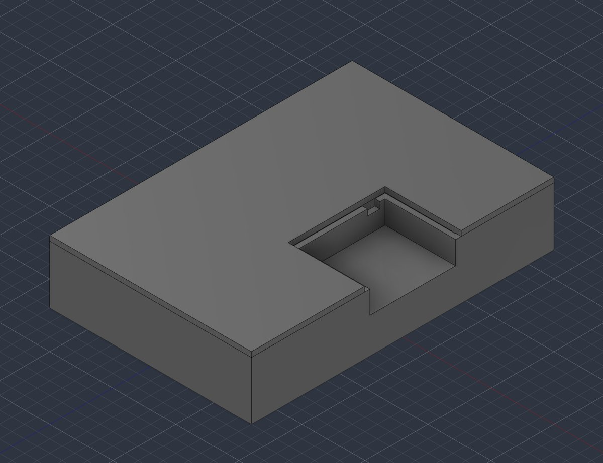
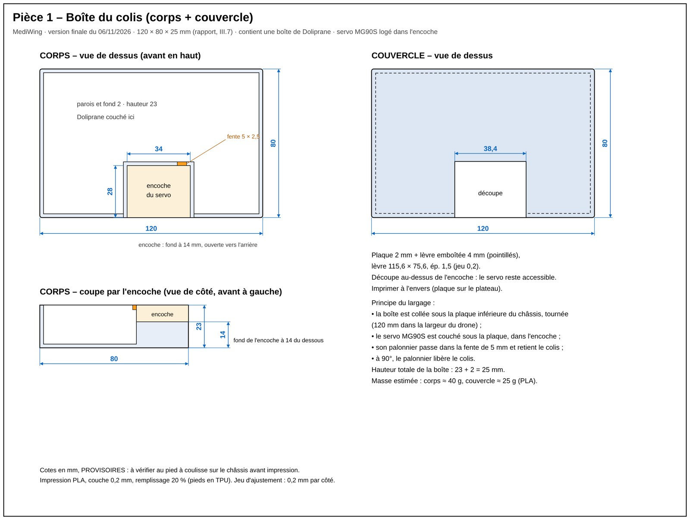
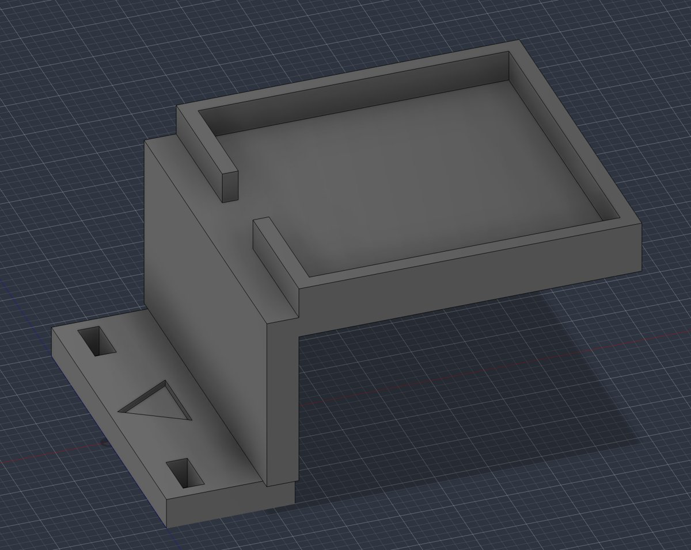
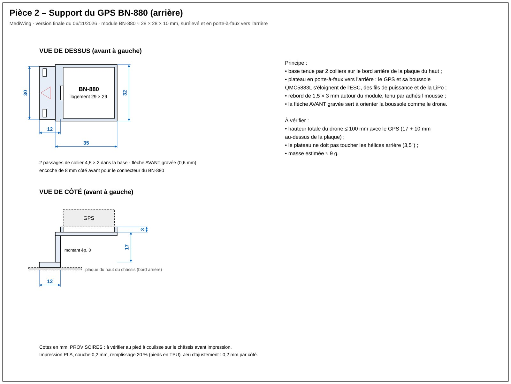
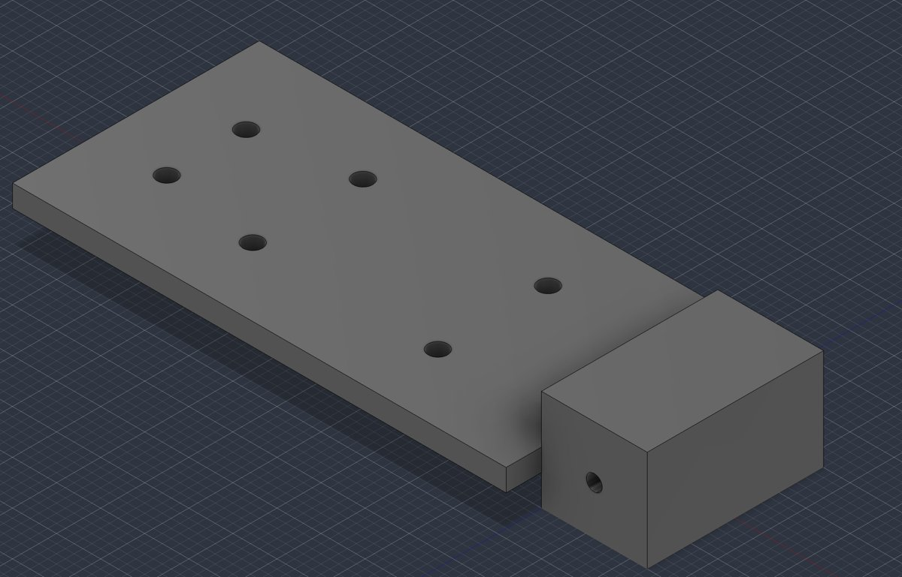
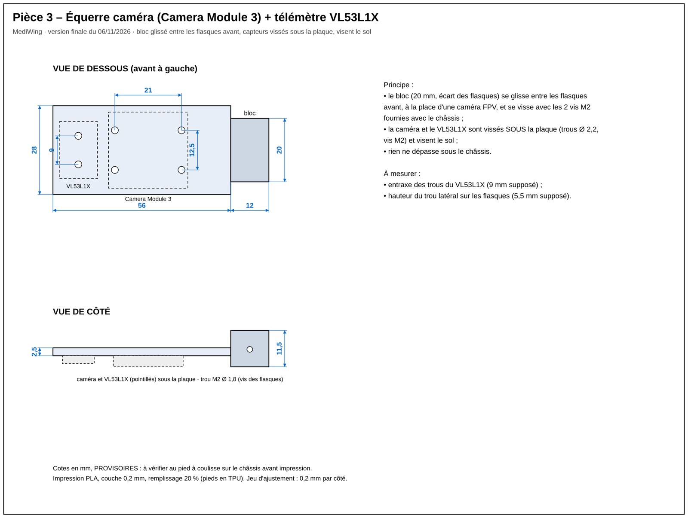
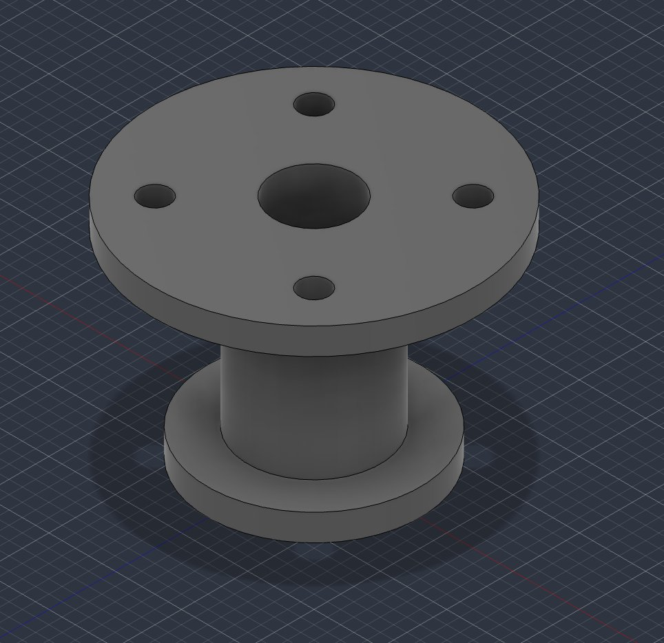
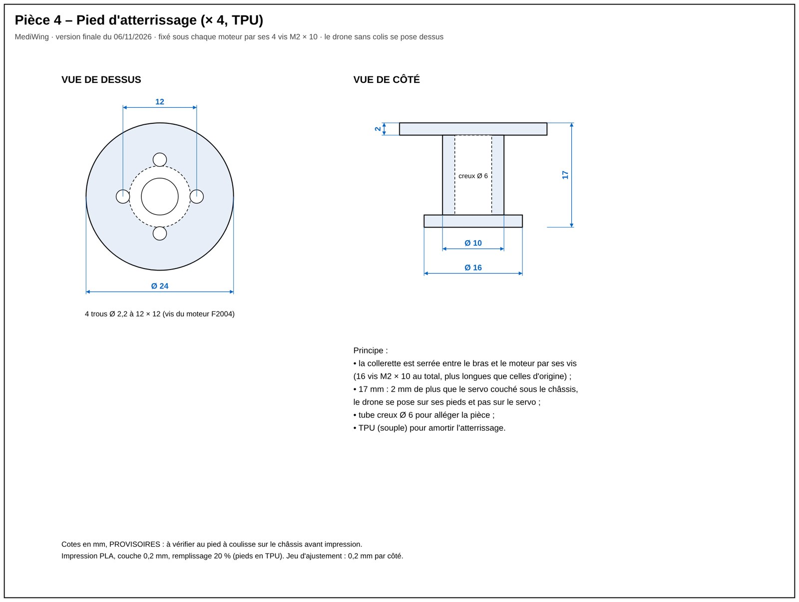
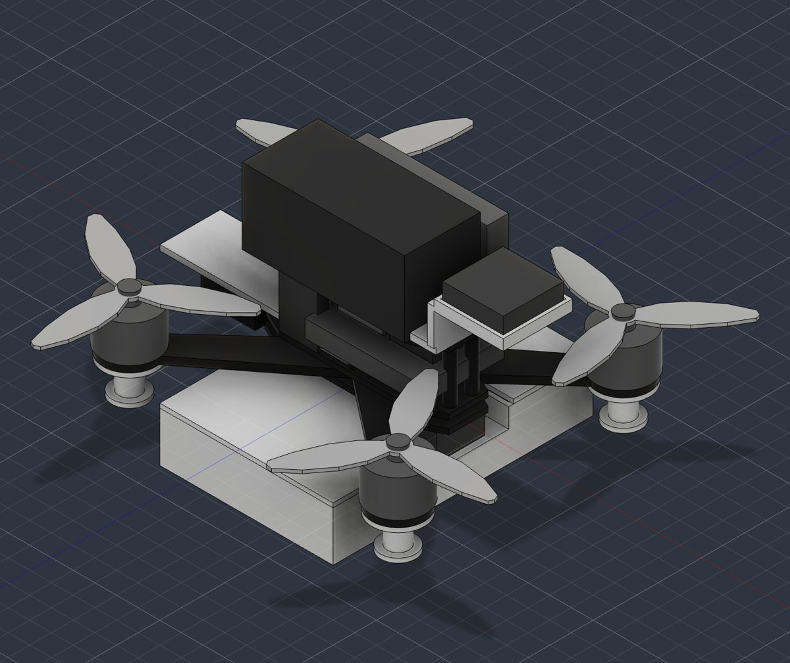
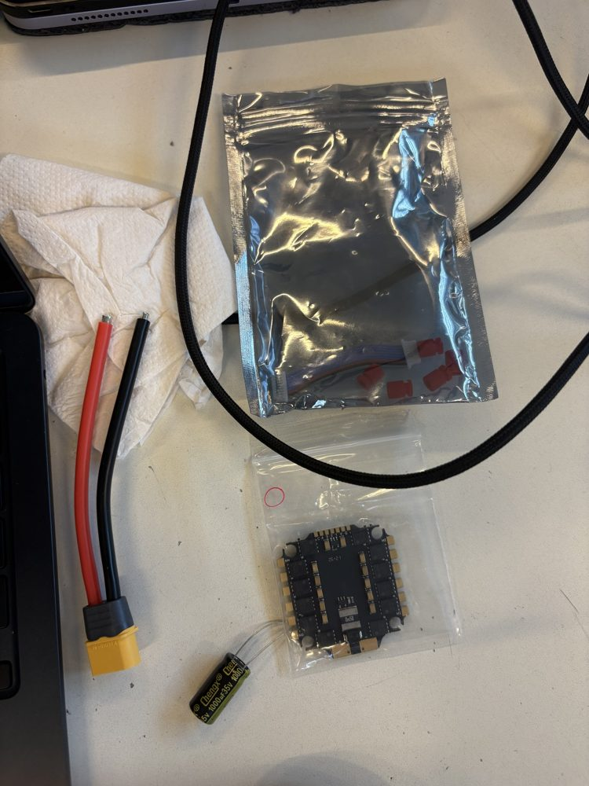

# Séance 1 – 06/11/2026

Vendredi 06/11/2026, 8h – 12h, salle D103.

## I. Objectif de la séance

D'après le planning prévisionnel du rapport bibliographique (tableau VII.1), cette première séance devait permettre de recevoir et d'inventorier le matériel, de configurer le firmware MultiWii 2.4 avec le pilote de la boussole QMC5883L, et de concevoir les pièces à imprimer en 3D : la boîte du colis, le loquet de largage et le support du GPS. Le résultat attendu était un firmware téléversé et des pièces prêtes à imprimer.

## II. Travail réalisé

### II.1. Conception des pièces imprimées en 3D

La séance a commencé par la CAO sous Fusion 360, avec M. Lebreton. La modélisation des pièces a occupé les trois premières heures. Le volume imposé par le cahier des charges (30 × 20 × 10 cm, hélices comprises) a guidé tous les choix : chaque pièce ajoutée sous le châssis réduit la marge en hauteur. Nous avons donc cherché à limiter le nombre de pièces.

| Pièce | Dimensions | Rôle |
|---|---|---|
| Boîte du colis + couvercle | 120 × 80 × 25 mm, parois de 2 mm | Contenir la boîte de Doliprane ; une encoche reçoit le servo MG90S qui retient puis libère la boîte |
| Support GPS | Logement 29 × 29 mm, plateau à 17 mm au-dessus de la plaque supérieure, en porte-à-faux vers l'arrière | Éloigner le BN-880 et sa boussole des câbles de puissance |
| Équerre caméra + VL53L1X | Plaque de 56 × 28 mm, ép. 2,5 mm, glissée entre les flasques avant | Orienter la caméra et le télémètre vers le sol pour l'atterrissage |
| Pieds (× 4, TPU) | 17 mm de haut, collerette Ø 24 mm, patin Ø 16 mm | Fixés sous chaque moteur par ses vis ; protéger la boîte et la caméra lors de l'atterrissage |

*Tableau 1. Pièces conçues pendant la séance*

Le support du loquet et le support de la Raspberry Pi, prévus au départ, ont été abandonnés. Avec un support de loquet séparé, l'ensemble loquet et boîte descendait d'environ 75 mm sous le châssis, ce qui ne laissait presque aucune marge sur les 10 cm de hauteur. En couchant le servo dans une encoche de la boîte, la fonction de largage est conservée sans pièce supplémentaire. Les cinq fichiers STL ont été exportés. Pour chaque pièce, les figures suivantes donnent le modèle 3D sous Fusion 360, puis son croquis coté. Les cotes restent provisoires : elles seront vérifiées au pied à coulisse sur le châssis avant l'impression.



*Figure 1. Boîte du colis fermée par son couvercle, avec l'encoche qui reçoit le servo MG90S*



*Figure 2. Croquis coté de la boîte du colis et de son couvercle (cotes en mm)*



*Figure 3. Support du GPS BN-880 ; la flèche gravée indique l'avant, car la boussole doit être orientée comme le drone*



*Figure 4. Croquis coté du support GPS (cotes en mm)*



*Figure 5. Équerre de la Camera Module 3 et du télémètre VL53L1X, vissés sous la plaque, avec le bloc de fixation aux flasques*



*Figure 6. Croquis coté de l'équerre caméra (cotes en mm)*



*Figure 7. Pied d'atterrissage (imprimé en quatre exemplaires, en TPU)*



*Figure 8. Croquis coté du pied d'atterrissage (cotes en mm)*

Pour vérifier que l'ensemble respecte le volume imposé, un prototype numérique du drone complet a ensuite été réalisé à partir de modèles simplifiés du châssis, des moteurs, des hélices et de l'électronique (Figure 9). Ce modèle a permis de contrôler l'absence de collision entre les hélices et les pièces ajoutées, ainsi que la hauteur totale. Les dimensions du corps du VX3.5 n'étant pas publiées, elles ont été estimées et devront être mesurées à la réception du châssis.



*Figure 9. Prototype numérique du drone assemblé avec la boîte, le support GPS, l'équerre caméra et les pieds*

### II.2. Inventaire du matériel

Un seul article de la commande est arrivé : l'ESC 4-en-1 HAKRC 35 A (BLHeli_S). Le colis contient la carte, une prise XT60 précâblée, un condensateur de 1000 µF 35 V, quatre silentblocs et la nappe de liaison vers la carte de vol (Figure 10). Le châssis Volador VX3.5 et les autres composants ne sont pas encore livrés. La pesée de l'ESC sera faite lors de la séance 2.



*Figure 10. ESC HAKRC 4-en-1 et ses accessoires à la réception*

### II.3. Configuration du firmware MultiWii 2.4

La configuration du firmware a été commencée pendant la dernière heure de la séance, puis terminée le soir même.

Nous n'avons pas écrit le firmware de vol : nous utilisons MultiWii 2.4, un logiciel libre développé par Alexandre Dubus et la communauté MultiWii [1]. Son code est distribué sous licence GNU GPL version 3 [2], qui autorise à le modifier et à le redistribuer à condition de conserver la licence et de rendre publiques les modifications. La version d'origine (`release-2.4`) a été copiée sans changement dans notre dépôt, puis modifiée dans un second temps : l'historique Git montre ainsi exactement ce que nous avons changé. Le texte de la licence est fourni avec le code (`firmware/MultiWii/LICENSE`).

Le fichier `config.h` a été adapté à notre matériel (Tableau 2).

| Paramètre | Valeur retenue | Justification |
|---|---|---|
| Type de drone | `QUADX` | Châssis VX3.5 en X |
| Capteurs | `MPU6050`, `BMP085` | Module GY-87 ; le BMP180 utilise le même pilote que le BMP085 |
| Boussole | `QMC5883L` (pilote ajouté) | Boussole du BN-880, éloignée des câbles de puissance |
| Récepteur | `SERIAL_SUM_PPM`, ordre ROLL, PITCH, THROTTLE, YAW | R8EF en PPM, un seul fil, broche 19 de la Mega |
| GPS | `GPS_SERIAL 2`, `UBLOX`, 57 600 bauds | BN-880 (u-blox M8) sur le port série 2 ; MultiWii le configure au démarrage |
| Sécurité | `FAILSAFE` activé | Réaction automatique à une perte de la liaison radio |
| Gaz minimum | `MINTHROTTLE 1070` | Valeur de départ pour un ESC BLHeli_S, à ajuster en S2 |

*Tableau 2. Réglages de MultiWii 2.4 pour notre drone*

MultiWii ne prend pas en charge la QMC5883L : un pilote a donc été ajouté dans `Sensors.cpp`, écrit sur le modèle du pilote HMC5883L déjà présent dans MultiWii. Ce composant remplace le HMC5883L sur la plupart des modules GPS récents, mais il n'est pas compatible avec lui : son adresse I2C (0x0D au lieu de 0x1E), ses registres de configuration et l'ordre de ses données sont différents. Le pilote règle le capteur en mode continu à 50 Hz sur une plage de ± 8 gauss, puis lit les trois axes. Nous avons également désactivé le mode « bypass » I2C du MPU-6050 : la boussole du GY-87, reliée au bus auxiliaire du MPU-6050, reste ainsi isolée du bus principal et ne peut pas entrer en conflit avec celle du BN-880.

Deux lignes de `GPS.cpp` ont aussi été corrigées : écrites en 2015, elles ne compilent plus avec les versions récentes de l'IDE Arduino (`error: flexible array member in union`).

La compilation a été vérifiée dans l'IDE Arduino, avec la carte « Arduino Mega or Mega 2560 ». La sortie obtenue est la suivante :

```
Le croquis utilise 31250 octets (12%) de l'espace de stockage de programmes. Le maximum est de 253952 octets.
Les variables globales utilisent 3211 octets (39%) de mémoire dynamique, ce qui laisse 4981 octets pour les variables locales. Le maximum est de 8192 octets.
```

Le programme n'occupe donc que 12 % de la mémoire de la Mega, ce qui laisse de la place pour la suite (liaison MSP avec la Raspberry Pi). La compilation ne demande pas la carte ; le téléversement et les essais des capteurs attendent en revanche la livraison de l'Arduino et des modules. Les sources sont dans le dossier [`firmware/`](../firmware/).

## III. Résultats

| Tâche | Durée |
|---|---|
| CAO des pièces (boîte, support GPS, équerre caméra, pieds) | 3 h |
| Configuration de MultiWii et pilote QMC5883L | 1 h en séance, terminé le soir |

*Tableau 3. Répartition du temps de la séance*

| Objectif de la séance | État | Commentaire |
|---|---|---|
| Inventaire du matériel | Partiel | 1 article reçu (ESC) |
| Firmware configuré, pilote QMC5883L | Atteint | Compilation réussie |
| Firmware téléversé | Non atteint | Arduino Mega pas encore livrée |
| Pièces 3D prêtes à imprimer | Partiel | 5 STL exportés, cotes du châssis à confirmer |

*Tableau 4. Bilan de la séance par rapport au planning*

## IV. Problèmes rencontrés et solutions

Le principal problème a été la hauteur maximale de 10 cm. La première version, avec un support de loquet séparé, faisait descendre la boîte d'environ 75 mm sous le châssis. Le servo a été intégré à la boîte, ce qui supprime une pièce et réduit la hauteur.

Dans Fusion 360, les pièces apparaissaient debout, car le logiciel était réglé avec l'axe Y vers le haut. Le passage de la direction de modélisation en « Z vers le haut » a résolu le problème.

Enfin, l'absence du châssis empêche de mesurer certaines cotes (position des vis, entraxe de fixation de l'équerre caméra). L'impression des pièces est donc reportée à la réception du VX3.5.

## V. Suite du projet

Il reste à téléverser le firmware dès la réception de l'Arduino Mega, à peser l'ESC lors de la séance 2 et à mesurer le châssis dès sa livraison pour ajuster puis imprimer les pièces.

La séance 2 (10/11) sera consacrée au banc d'essai : soudure de la prise XT60 et du condensateur sur l'ESC, câblage du GY-87, du BN-880 et du récepteur R8EF, vérification des capteurs dans MultiWiiConf, appairage de la radiocommande, puis essai des moteurs sans hélices.

## Références

[1] MultiWii, dépôt officiel du firmware, version `release-2.4` (2015). https://github.com/multiwii/multiwii-firmware

[2] Free Software Foundation, *GNU General Public License*, version 3 (2007). https://www.gnu.org/licenses/gpl-3.0.html
