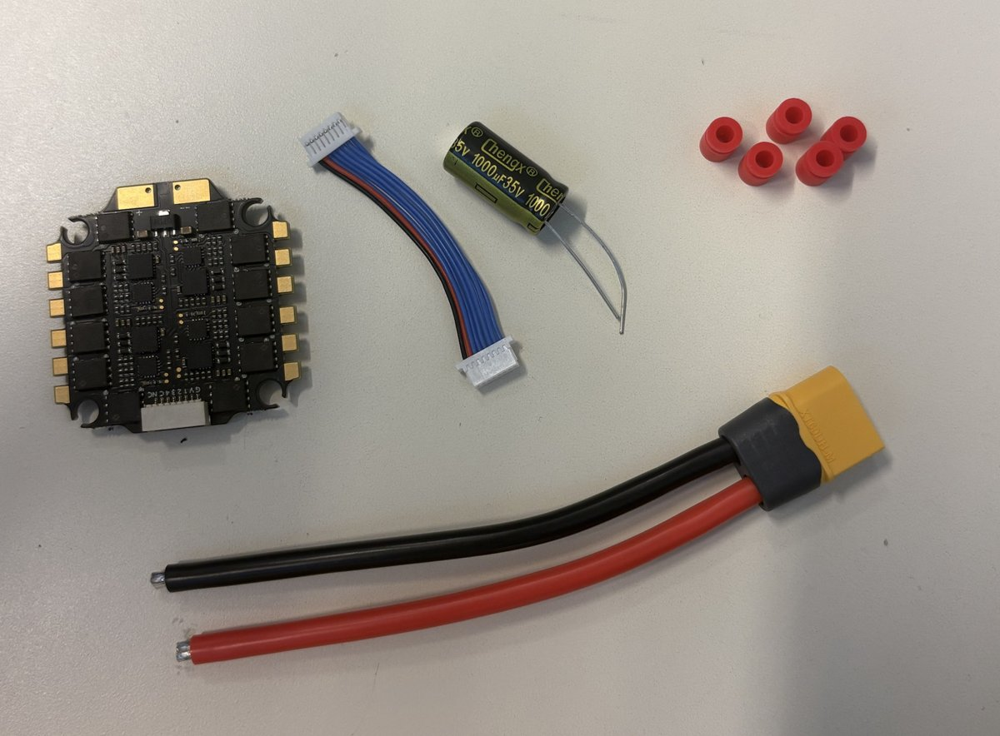
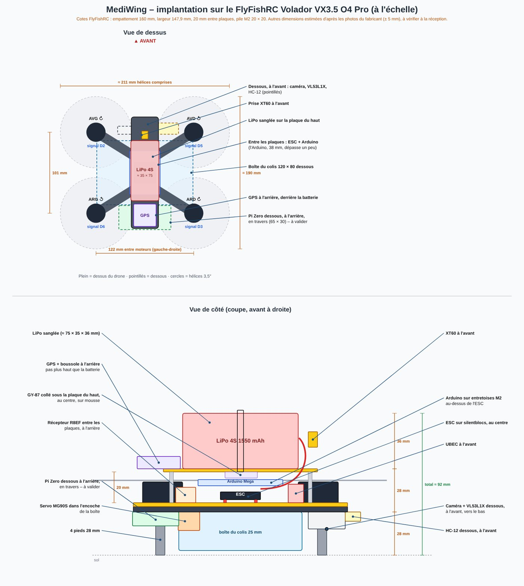
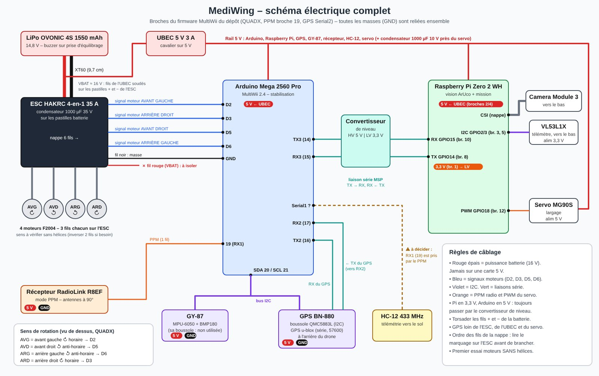
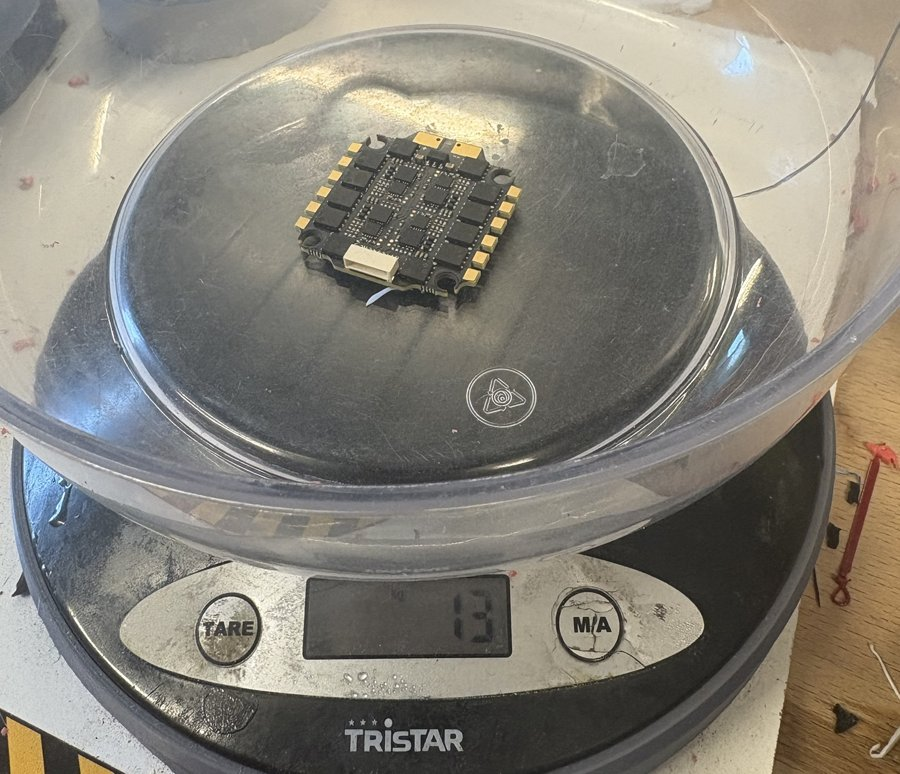
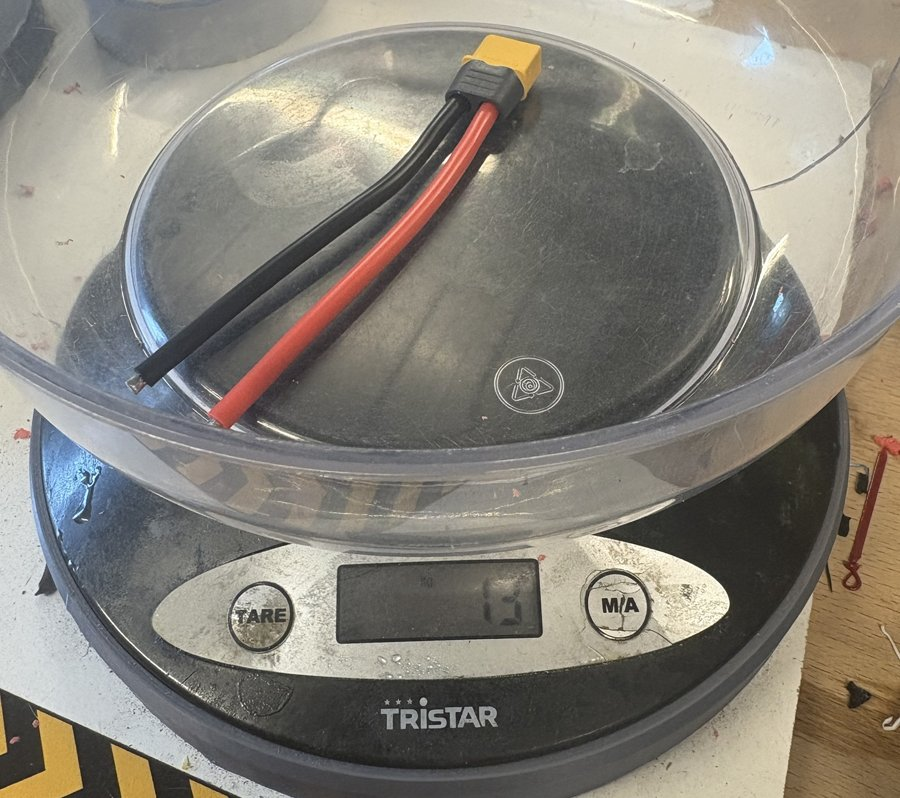
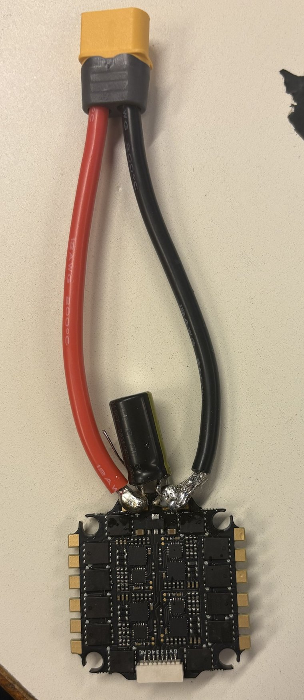
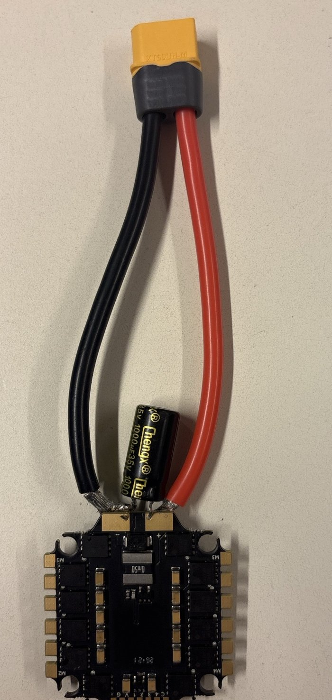
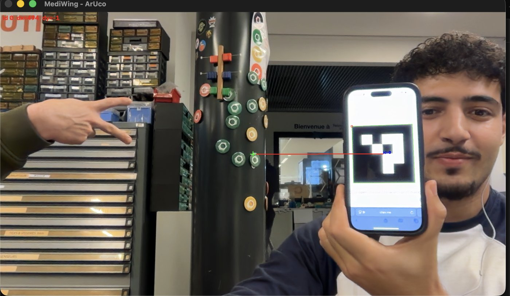

# Séance 2 – 10/11/2026

Mehdi Krifa, groupe 13 · mardi 10/11/2026, 13h30 – 17h30, salle D103.

## I. Objectif de la séance

D'après le planning prévisionnel du rapport bibliographique (tableau VII.1), cette deuxième séance devait être consacrée au banc d'essai : souder la prise XT60 et le condensateur sur l'ESC, câbler les capteurs et le récepteur sur l'Arduino, vérifier les capteurs dans MultiWiiConf, appairer la radiocommande, puis faire tourner les moteurs sans hélices. Il restait aussi deux tâches de la séance 1 : peser l'ESC et téléverser le firmware MultiWii.

Au début de la séance, l'ESC était toujours le seul article reçu. Le travail a donc porté sur ce qui pouvait être fait sans les autres pièces : la préparation du montage, les pesées, le firmware, la soudure de l'ESC et, en avance sur le planning, un premier essai de détection de marqueur ArUco.

## II. Travail réalisé

### II.1. Préparation de la soudure et étude de l'ESC

Avant de souder, nous avons identifié chaque élément livré avec l'ESC HAKRC 4-en-1 (Figure 1) :

- les deux pastilles de batterie (+ et −), percées chacune d'un trou traversant ;
- la prise XT60 précâblée, de 11,7 cm au total (2 cm de prise et 9,7 cm de fil) ;
- le condensateur de 1000 µF 35 V, qui absorbe les pics de tension renvoyés par les moteurs sur la batterie ;
- les quatre silentblocs rouges, qui isolent l'ESC des vibrations du châssis ;
- la nappe qui transmet les signaux des quatre moteurs depuis la carte de vol.

Les pastilles étant traversantes, la méthode retenue consiste à passer les pattes du condensateur dans les trous, à poser le fil de la XT60 par-dessus et à souder le tout en une seule fois. Le fil de la XT60 a été gardé à sa longueur d'origine : il pourra être raccourci côté ESC si nécessaire lors du montage.



*Figure 1. ESC HAKRC 4-en-1, nappe, condensateur, silentblocs et prise XT60 avant la soudure*

### II.2. Implantation de l'électronique sur le châssis

Le châssis n'étant pas encore livré, ses cotes ont été relevées sur le site du fabricant FlyFishRC : 20 mm entre la plaque inférieure et la plaque supérieure, une pile de cartes fixée en M2 (entraxe 20 × 20 mm ou 25,5 × 25,5 mm) et 147,9 mm de largeur d'un bout de bras à l'autre. L'ESC, en 20 × 20 mm, se monte donc directement sur ses silentblocs.

La hauteur de 20 mm ne permet pas d'empiler l'ESC, l'Arduino et le GY-87 comme prévu dans le rapport. Le GY-87 sera donc fixé sous la plaque supérieure, au centre du drone. De même, la Raspberry Pi (65 × 30 mm) ne tient pas sur la plaque supérieure à côté de la batterie et du GPS : elle est provisoirement placée sous le drone, à l'arrière. Un schéma d'implantation à l'échelle (Figure 2) et le schéma électrique complet (Figure 3) ont été réalisés à partir de ces cotes. Ces choix restent à valider au montage, en séance 3.



*Figure 2. Implantation de l'électronique sur le VX3.5, vue de dessus et vue de côté, à l'échelle*



*Figure 3. Schéma électrique complet du drone, avec les broches utilisées sur l'Arduino Mega*

### II.3. Pesées

L'ESC et la prise XT60 ont été pesés séparément sur la balance de la salle (Figures 4 et 5).



*Figure 4. Pesée de l'ESC seul : 13 g*



*Figure 5. Pesée de la prise XT60 avec ses fils : 13 g*

L'ESC pèse 13 g, contre environ 6 g annoncés par le fabricant. Le bilan de masse du rapport (tableau III.4) prévoyait 10 g pour la ligne « ESC, condensateur et câbles » ; après soudure, l'ensemble pèse 30 g, soit 20 g de plus. La masse à vide estimée passe ainsi d'environ 480 g à environ 500 g. Avec la charge utile maximale de 300 g, le drone atteindrait environ 800 g, soit la limite du cahier des charges. Pour la mission réelle, avec une boîte de Doliprane d'environ 30 g, la masse reste proche de 530 g. Le bilan sera mis à jour avec la pesée du drone assemblé.

### II.4. Téléversement du firmware MultiWii

La Mega 2560 Pro commandée n'étant pas encore arrivée, le firmware configuré en séance 1 a été téléversé sur une Arduino Mega 2560 classique de la salle. Les deux cartes utilisent le même microcontrôleur (ATmega2560) et les mêmes broches : le test est donc valable. Dans l'IDE Arduino, la carte a d'abord été reconnue à tort comme une « Arduino UNO » ; il a suffi de choisir manuellement « Arduino Mega or Mega 2560 ». La compilation donne exactement le même résultat qu'en séance 1 :

```
Le croquis utilise 31250 octets (12%) de l'espace de stockage de programmes. Le maximum est de 253952 octets.
Les variables globales utilisent 3211 octets (39%) de mémoire dynamique, ce qui laisse 4981 octets pour les variables locales. Le maximum est de 8192 octets.
```

Aucun capteur n'étant encore branché, la vérification dans MultiWiiConf est reportée.

Cette Mega classique (101,6 × 53,3 mm, environ 37 g) ne peut pas être montée sur le drone. La Mega 2560 Pro mesure 54 × 38 mm, mais ses deux trous de fixation (Ø 3,2 mm) ne correspondent pas à la pile M2 de l'ESC : elle sera fixée sur l'ESC avec de la mousse double face et un serflex, prise USB orientée vers l'extérieur pour pouvoir la reprogrammer sans démontage.

### II.5. Soudure de la XT60 et du condensateur

C'était la première fois que je soudais. M. Lebreton m'a grandement aidé tout au long de la soudure. La procédure suivie est la suivante :

1. LiPo éloignée du poste, lunettes de protection, ESC fixé à plat, face marquée + / − vers le haut.
2. Pattes du condensateur passées dans les trous par le dessus : patte longue dans le +, patte du côté de la bande claire dans le −. Le corps du condensateur reste couché à plat entre les deux fils, en dehors de la carte, car il n'y a pas la place de le loger sous l'ESC.
3. Fil rouge posé sur la pastille +, par-dessus la patte, puis soudé en une seule fois : panne posée contre la pastille, le fil et la patte, puis étain amené sur la pastille jusqu'à ce que tout soit recouvert.
4. Même opération pour le fil noir sur la pastille −, en vérifiant qu'aucun étain ne relie les deux pastilles.
5. Pattes du condensateur coupées au ras de la soudure.

Le fer a été réglé à environ 360 °C. Les pastilles de batterie, reliées à de grandes surfaces de cuivre, absorbent beaucoup de chaleur : à température plus basse, l'étain met trop longtemps à couler, ce qui abîme la pastille et donne une soudure terne.

N'ayant jamais soudé, j'ai parfois eu peur de mal faire : abîmer l'ESC en chauffant trop longtemps, ou créer un pont d'étain entre le + et le −. En avançant étape par étape et avec les conseils de M. Lebreton, j'ai finalement réussi les deux soudures.

La soudure a ensuite été contrôlée et validée par M. Masson. L'ensemble soudé pèse 30 g.



*Figure 6. XT60 et condensateur soudés, face supérieure de l'ESC*



*Figure 7. Face inférieure : le fil rouge arrive bien sur la pastille marquée « + »*

Cette première soudure m'a appris beaucoup de choses : la préparation du poste, le geste de base, l'importance de chauffer la pastille et non l'étain, et la façon de reconnaître une bonne soudure (brillante, lisse, en forme de cône). À l'avenir, je pourrai réaliser seul les soudures du drone, à commencer par celles des moteurs en séance 3.

### II.6. Détection d'un marqueur ArUco à la webcam

Le temps restant a été utilisé pour avancer la partie vision, prévue en séance 5. Un script Python (`aruco_webcam.py`) utilise OpenCV pour détecter un marqueur ArUco du dictionnaire 4 × 4 (n° 0) dans l'image de la webcam du PC. Il calcule l'écart en pixels entre le centre du marqueur et le centre de l'image (dx vers la droite, dy vers le bas). C'est cet écart qui servira à recentrer le drone au-dessus du marqueur avant l'atterrissage. OpenCV 5.0 a été installé dans un environnement Python dédié.

Le marqueur, affiché sur un téléphone, est bien détecté (Figure 8). Placé à gauche du centre, il donne dx = −619 px et dy = +37 px ; placé à droite, à la même hauteur que le centre, il donne dx = +494 px et dy = −1 px. Le signe de dx suit donc bien le côté où se trouve le marqueur.



*Figure 8. Marqueur n° 0 détecté à droite du centre : cadre vert, ligne rouge vers le centre de l'image, écart affiché en haut à gauche (dx = +494 px, dy = −1 px)*

## III. Résultats

| Tâche | Horaire (environ) |
|---|---|
| Préparation de la soudure, étude de l'ESC | 13h30 – 14h10 |
| Cotes du châssis, schémas d'implantation et électrique | 14h10 – 14h30 |
| Pesées de l'ESC et de la XT60 | 14h30 – 14h45 |
| Téléversement du firmware MultiWii | 14h45 – 15h05 |
| Soudure de la XT60 et du condensateur, validation | 15h15 – 16h45 |
| Détection ArUco à la webcam | 16h45 – 17h05 |
| Photos, retouches et rangement | 17h05 – 17h30 |

*Tableau 1. Répartition du temps de la séance*

| Objectif de la séance | État | Commentaire |
|---|---|---|
| Peser l'ESC (reste de S1) | Atteint | 13 g seul, 30 g soudé avec la XT60 |
| Téléverser le firmware (reste de S1) | Atteint | Sur une Mega 2560 classique ; la Mega Pro n'est pas livrée |
| Souder la XT60 et le condensateur | Atteint | Validé par M. Masson |
| Banc d'essai capteurs et récepteur | Non atteint | GY-87, BN-880 et R8EF pas encore livrés |
| Vérification dans MultiWiiConf | Non atteint | Aucun capteur branché |
| Appairage de la radiocommande | Non atteint | Radio pas encore livrée |
| Essai des moteurs sans hélices | Non atteint | Moteurs pas encore livrés |
| Détection ArUco (prévue en S5) | Atteint en avance | Validée à la webcam du PC |

*Tableau 2. Bilan de la séance par rapport au planning*

## IV. Problèmes rencontrés et solutions

Le principal problème reste l'absence de la plupart des pièces. Le travail a été réorganisé pour avancer sur ce qui ne dépendait que de l'ESC, de l'Arduino de la salle et du PC.

La hauteur de 20 mm entre les plaques du châssis ne permet pas la pile ESC, Arduino et GY-87 prévue. Le GY-87 a été déplacé sous la plaque supérieure. La Raspberry Pi, qui ne tient pas sur la plaque supérieure, a été placée sous le drone, à l'arrière ; ce point sera confirmé au montage.

La masse de l'ESC (13 g au lieu des 6 g annoncés) et de la XT60 fait passer la masse à vide estimée à environ 500 g. La charge utile de 300 g reste possible, mais sans marge ; la mission réelle, avec une boîte de Doliprane, reste largement sous les 800 g.

Lors du téléversement, l'IDE Arduino a reconnu la Mega comme une « Arduino UNO ». Le choix manuel de la carte a résolu le problème.

## V. Suite du projet

La soudure n'a pas encore été testée au multimètre. Avant le premier branchement de la LiPo, un test de continuité sera fait : chaque broche de la XT60 doit être reliée à sa pastille, sans court-circuit entre le + et le −.

Avant le montage, trois retouches de quelques minutes sont prévues sur l'ESC : couper les quelques brins du fil noir qui dépassent de la soudure, maintenir le condensateur contre les fils avec un serflex ou un point de colle chaude, et nettoyer les traces de flux à l'alcool isopropylique.

La séance 3 (17/11) reprendra d'abord les tâches reportées, selon les pièces reçues : banc d'essai des capteurs et du récepteur, vérification dans MultiWiiConf, appairage de la radiocommande et calibration des ESC sans hélices. Si le châssis et les moteurs sont arrivés, elle enchaînera sur le montage du drone et le contrôle de la masse et de la hauteur.

## Références

[1] FlyFishRC, *Volador VX3.5 FPV Frame*, fiche produit (dimensions et montage). https://www.flyfishrc.com

[2] OpenCV, *Detection of ArUco Markers*, documentation officielle. https://docs.opencv.org/4.x/d5/dae/tutorial_aruco_detection.html
