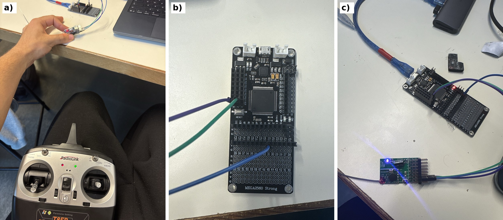
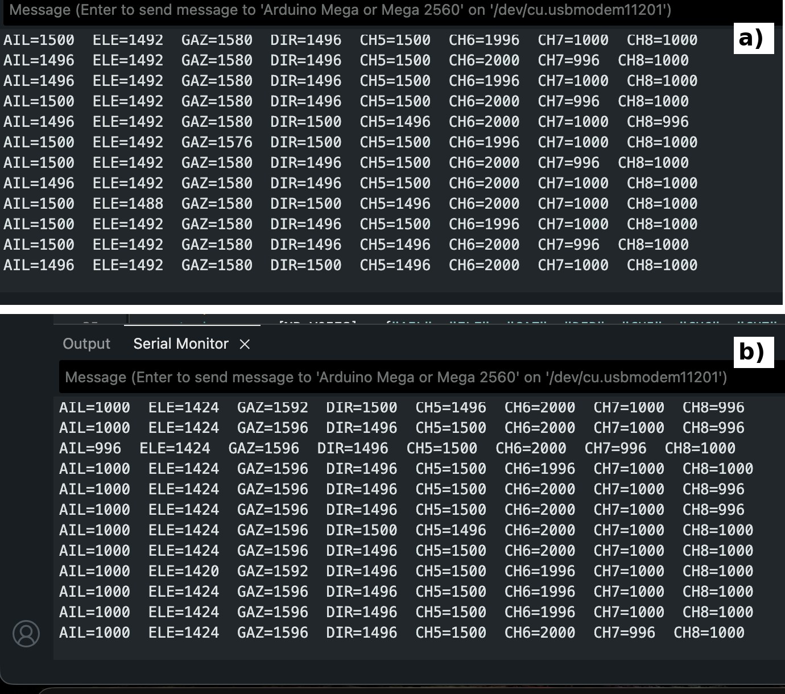
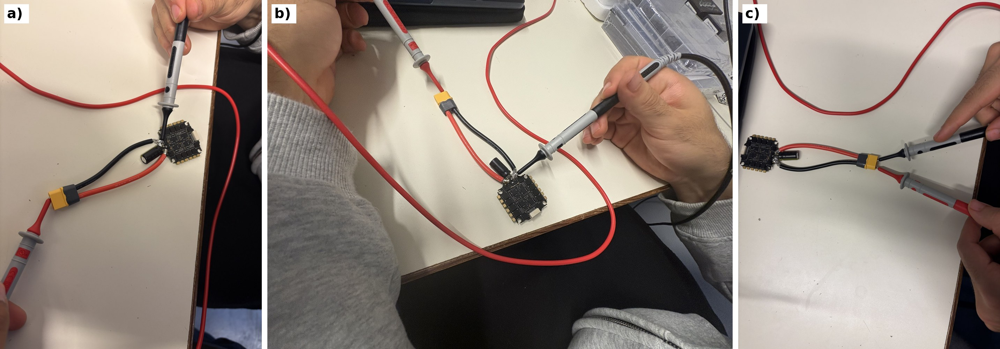
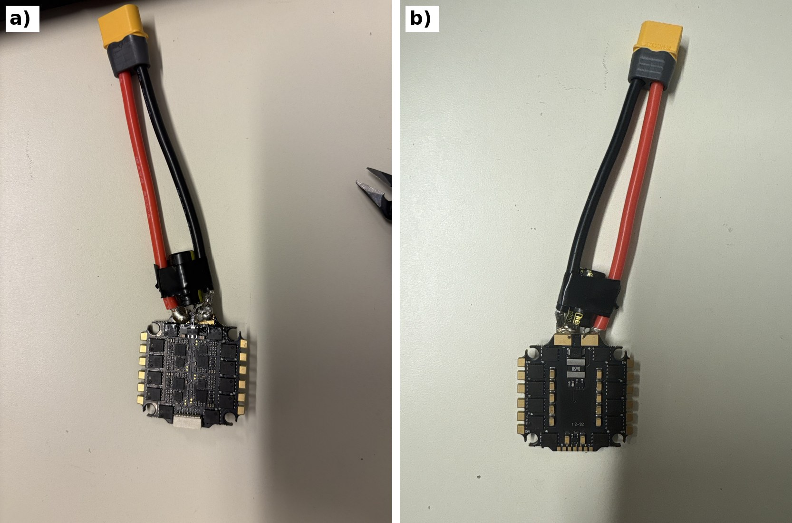

# Séance 3 – 17/11/2026

Mehdi Krifa, groupe 13 · mardi 17/11/2026, 13h30 – 17h30, salle D103.

## I. Objectif de la séance

D'après le planning prévisionnel du rapport bibliographique (tableau VII.1), cette troisième séance devait être consacrée au montage du drone : fixer les moteurs sur le châssis et les souder sur l'ESC, installer l'électronique, faire un premier branchement de la LiPo sans hélices, puis contrôler la masse et la hauteur. Il restait aussi plusieurs tâches de la séance 2 : le contrôle au multimètre de l'ESC soudé et ses finitions, le banc d'essai du récepteur et l'appairage de la radiocommande.

Une partie du matériel est arrivée en début de séance, mais pas le châssis. Le programme a donc été adapté : inventaire des pièces reçues, essai de la chaîne radio sur une Arduino Mega de la salle, pesée des nouvelles pièces, puis contrôle et finitions de l'ESC.

## II. Travail réalisé

### II.1. Inventaire du matériel

Les colis reçus ont été déballés et comparés à la liste du rapport (tableau VI.1). Le tableau 1 donne l'état du matériel au 17/11/2026.

| Composant | Quantité | État au 17/11 |
|---|---|---|
| ESC HAKRC 4-en-1 35 A BLHeli_S | 1 | Reçu en S1, soudé en S2 |
| Moteurs T-Motor F2004 3000 KV | 4 | Reçus |
| Radiocommande RadioLink T8FB et récepteur R8EF | 1 | Reçus |
| Modules radio HC-12 433 MHz | 2 | Reçus |
| Régulateur UBEC 5 V 3 A | 1 | Reçu |
| Télémètre laser VL53L1X | 1 | Reçu |
| Testeurs de LiPo | 2 | Reçus |
| Nappe caméra pour Pi Zero | 1 | Reçue |
| Câbles XT60, sangles de batterie, fil silicone, entretoises | – | Reçus |
| Gaine thermorétractable (coffret) | 1 | Reçue en cours de séance |
| GPS BN-880 avec boussole | 1 | Mauvais modèle reçu (BN-180), rendu pour échange |
| Châssis FlyFishRC Volador VX3.5 | 1 | Manquant |
| Arduino Mega 2560 Pro | 1 | Manquante |
| Module GY-87 (gyroscope, accéléromètre, baromètre) | 1 | Manquant |
| Batteries LiPo OVONIC 4S 1550 mAh et chargeur | 2 + 1 | Manquants |
| Hélices Gemfan 3525 tripales | 2 lots | Manquantes |
| Raspberry Pi Zero 2 WH et Camera Module 3 | 1 + 1 | Manquantes |
| Convertisseur de niveau logique 3,3 V / 5 V | 1 | Manquant |
| Servo MG90S | 1 | Manquant |

*Tableau 1. État du matériel au 17/11/2026*

Le module GPS reçu est un BN-180 au lieu du BN-880 prévu. Le BN-180 n'a pas de boussole intégrée : son câble n'a que quatre fils, contre six pour le BN-880, dont deux servent à la boussole. Or le drone en a besoin pour connaître son cap pendant la navigation autonome. Le BN-180 a été rendu à M. Masson, et un mail a été envoyé pour signaler l'erreur. Le BN-880 va être commandé.

### II.2. Essai de la radiocommande et du récepteur

L'objectif de cet essai est de vérifier toute la chaîne de commande avant le montage : de la radiocommande T8FB au récepteur R8EF, puis du récepteur à l'Arduino Mega. Le firmware MultiWii lit en effet les ordres du pilote sur une seule broche, la broche 19, au format PPM : les huit voies de la radio y arrivent les unes après les autres sur un seul fil.

La Mega 2560 Pro n'étant pas encore livrée, l'essai a été fait sur une Mega 2560 « Strong » de la salle, alimentée par le câble USB du PC. Elle utilise le même microcontrôleur que la Mega Pro, ce qui rend l'essai valable. La radiocommande a été équipée de ses quatre piles AA et émet un bip au démarrage. Le récepteur a été relié à la Mega par trois fils Dupont mâle-femelle (Figure 1) :

- fil bleu : signal du port PPM du R8EF (port CH2) vers la broche 19 ;
- fil vert : + du récepteur vers la rangée V (5 V) ;
- fil violet : − du récepteur vers la rangée G (masse).

Pour appairer le récepteur, il faut maintenir le bouton ID SET du R8EF environ une seconde, radiocommande allumée à proximité : la LED clignote, puis reste fixe une fois l'appairage terminé [1]. La LED est d'abord restée rouge fixe, ce qui correspond au mode PWM, où chaque voie a sa propre broche. Deux appuis brefs sur ID SET ont fait passer la LED au bleu, c'est-à-dire en mode PPM [1].

Le R8EF propose trois sorties : PWM, SBUS et PPM [1]. Le mode PPM a été retenu pour trois raisons :

- en PWM, chaque voie sort sur son propre fil : il faudrait huit fils et huit broches de l'Arduino pour lire les huit voies, alors qu'en PPM un seul fil suffit, ce qui laisse les autres broches libres pour le GPS, le module HC-12, la Raspberry Pi et le servo de largage ;
- le SBUS transmet aussi toutes les voies sur un seul fil, mais c'est une liaison série au signal inversé : l'ATmega2560 ne sait pas le lire directement, il faudrait ajouter un inverseur, et le SBUS occuperait l'un des ports série de la Mega, déjà réservés au GPS, à la Raspberry Pi et au HC-12 ;
- le PPM est directement pris en charge par MultiWii (option `SERIAL_SUM_PPM`, configurée en séance 1), sans composant supplémentaire.

*Figure 1. a) Radiocommande T8FB allumée ; b) câblage sur la Mega 2560 Strong (bleu : broche 19, vert : 5 V, violet : masse) ; c) R8EF appairé en PPM, LED bleue*

Pour lire les voies, un petit programme de test (`ppm_test.ino`) a été téléversé à la place de MultiWii. Il mesure la durée de chaque impulsion sur la broche 19 et affiche les huit voies dans le Moniteur série, à 115 200 bauds. Les quatre voies principales (AIL pour le roulis, ELE pour le tangage, GAZ et DIR pour le lacet) varient bien de 1000 à 2000 µs, avec environ 1500 µs au centre. Les voies CH5 à CH8, reliées aux interrupteurs, restent stables (Figure 2).

*Figure 2. Moniteur série : a) manches au repos, valeurs proches de 1500 µs ; b) manche droit poussé à gauche, AIL = 1000 µs*

Au début, j'ai cru qu'un manche ne commandait pas la bonne voie : DIR montait à 1996 µs alors que je pensais bouger le roulis. En bougeant les manches un par un, j'ai vérifié que chaque voie répondait au bon manche : le manche droit poussé à gauche donne bien AIL = 1000 µs. Les quatre voies sont donc correctes.

Cet essai prépare plusieurs étapes de la suite du projet :

- MultiWii recevra les ordres sur cette même broche 19, sans modifier le câblage ;
- le premier vol se fera en pilotage manuel avec cette radiocommande ;
- pendant le vol autonome, le télépilote pourra reprendre la main à tout moment, ce qui est la base de la sécurité du drone ;
- les interrupteurs des voies CH5 à CH8 serviront à armer les moteurs et à changer de mode de vol.

Le programme de test a remplacé MultiWii sur cette Mega de la salle : le firmware sera téléversé sur la Mega 2560 Pro dès sa réception.

### II.3. Pesées

Les nouvelles pièces ont été pesées sur la balance de la salle, avec une précision de 1 g (Tableau 2).

| Pièce | Masse mesurée |
|---|---|
| Moteur F2004 (un seul) | 16 g, soit 64 g pour les quatre |
| Régulateur UBEC 5 V | 10 g |
| Câble XT60 | 9 g |
| Récepteur R8EF | 5 g |
| Module HC-12 avec son antenne ressort | 2 g |
| Télémètre VL53L1X, sans sa barrette de broches | 1 g |
| ESC terminé, avec la XT60, le condensateur et le ruban isolant (partie II.4) | 31 g |

*Tableau 2. Masses des pièces reçues et de l'ESC terminé*

Les pièces reçues pèsent 91 g au total. L'ESC a été repesé après les finitions de la partie II.4, avec la XT60, le condensateur et le ruban isolant qui les maintient : il pèse 31 g, contre 30 g en séance 2. Le bilan de masse complet sera fait sur le drone assemblé.

### II.4. Contrôle et finitions de l'ESC

La soudure de la séance 2 n'avait pas encore été testée électriquement. Ce contrôle est obligatoire avant de brancher une LiPo pour la première fois : un court-circuit entre le + et le − ferait débiter la batterie sans limite, avec un risque d'incendie.

Le contrôle a été fait au multimètre de table Metrix MX5006, en mode continuité : le multimètre bipe quand ses deux pointes sont reliées électriquement. Sur ce modèle, le mode continuité n'a pas de position propre sur la molette : il faut se placer sur Ω, puis appuyer sur la touche jaune MODE [2]. J'ai mis un moment à le trouver. Le cordon noir était branché sur la borne COM et le rouge sur la borne VΩ. Trois tests ont été faits (Figure 3) :

| Test | Pointes | Résultat attendu | Résultat obtenu |
|---|---|---|---|
| A | Pastille + de l'ESC et broche + de la XT60 | Bip continu | Bip continu |
| B | Pastille − de l'ESC et broche − de la XT60 | Bip continu | Bip continu |
| C | Broche + et broche − de la XT60 | Pas de bip continu | Bip très bref, puis silence |

*Tableau 3. Tests de continuité de l'ESC*

Les tests A et B montrent que chaque fil est bien relié à sa pastille. Au test C, le bip très bref vient du condensateur de 1000 µF, qui se charge sous la petite tension du multimètre ; une fois chargé, il ne laisse plus passer de courant et le bip s'arrête. Aux essais suivants, il n'y avait plus aucun bip. Il n'y a donc pas de court-circuit : l'ESC peut recevoir une LiPo.

*Figure 3. Tests de continuité : a) test A, côté + ; b) test B, côté − ; c) test C, entre le + et le − de la XT60*

Deux finitions restaient à faire. D'abord, quelques brins de cuivre du fil noir dépassaient de la soudure. Ils n'ont pas été coupés, car ils sont orientés vers l'extérieur, loin de la pastille + ; ils ont été recouverts de ruban isolant, pour qu'ils ne puissent pas se plier vers le + sous l'effet des vibrations. Ensuite, le condensateur devait être maintenu contre les fils, pour que ses pattes ne cassent pas avec les vibrations. Faute de collier de serrage disponible, il a été fixé avec le même ruban isolant, qui tient à la fois le condensateur et les deux fils (Figure 4).

*Figure 4. ESC terminé : a) face supérieure, condensateur maintenu par le ruban isolant ; b) face inférieure*

## III. Résultats

| Tâche | Horaire |
|---|---|
| Déballage, inventaire et identification du GPS reçu | 13h35 – 14h10 |
| Mise en place de la radiocommande et câblage du récepteur sur la Mega | 14h20 – 14h45 |
| Appairage, passage en PPM et lecture des voies au Moniteur série | 15h00 – 15h25 |
| Pesées et identification du télémètre | 15h35 – 16h00 |
| Réception de la gaine thermorétractable, organisation de la fin de séance | 16h05 – 16h25 |
| Tests de l'ESC au multimètre | 16h25 – 16h50 |
| Fixation du condensateur et photos de l'ESC | 16h50 – 17h05 |
| Retour du GPS à M. Masson, rangement | 17h05 – 17h30 |

*Tableau 4. Répartition du temps de la séance*

| Objectif de la séance | État | Commentaire |
|---|---|---|
| Contrôle au multimètre de l'ESC (reste de S2) | Atteint | Pas de court-circuit, ESC prêt pour la LiPo |
| Finitions de l'ESC (reste de S2) | Atteint | Condensateur et brins maintenus par du ruban isolant |
| Appairage de la radiocommande (reste de S2) | Atteint | R8EF en PPM, 4 voies lues sur la broche 19 |
| Inventaire du matériel | Atteint | Tableau 1 |
| Pesée des pièces reçues | Atteint | 91 g au total, ESC terminé 31 g (Tableau 2) |
| Banc d'essai des capteurs dans MultiWiiConf | Non atteint | GY-87 et GPS pas encore disponibles |
| Montage des moteurs sur le châssis | Non atteint | Châssis pas encore livré |
| Premier branchement de la LiPo sans hélices | Non atteint | Châssis et LiPo pas encore livrés |
| Contrôle de la masse et de la hauteur | Non atteint | Drone pas encore assemblé |

*Tableau 5. Bilan de la séance par rapport au planning*

## IV. Problèmes rencontrés et solutions

Le module GPS reçu n'était pas le bon modèle : un BN-180, sans boussole, au lieu du BN-880. Il a été identifié grâce à son câble à quatre fils, rendu à M. Masson et signalé par mail.

Pour l'essai radio, les premiers fils Dupont pris étaient mâle-mâle et ne pouvaient pas se brancher sur le récepteur : ils ont été remplacés par des fils mâle-femelle. Le bouton ID SET du R8EF a été difficile à trouver : c'est un petit bouton sur la tranche du récepteur, caché sous son film de protection, que j'ai fini par retirer. Il a aussi fallu apprendre à ouvrir le Moniteur série de l'IDE Arduino et à le régler à la bonne vitesse (115 200 bauds) pour lire les valeurs.

Lors du contrôle de l'ESC, le mode continuité du multimètre Metrix n'apparaît pas sur la molette. Il s'obtient avec la position Ω et la touche MODE. Enfin, aucun collier de serrage n'étant disponible, le condensateur a été fixé au ruban isolant.

## V. Suite du projet

Les pièces imprimées en 3D conçues en séance 1 peuvent être lancées à l'impression, pour être fixées dès la réception du châssis. Les quatre pieds se fixent sous les moteurs, désormais disponibles : l'entraxe de leurs trous sera vérifié sur un moteur avant l'impression. La boîte du colis ne dépend que du servo MG90S. En revanche, le support GPS sera vérifié sur le BN-880, et l'équerre de la caméra sur le châssis, avant d'être imprimés.

Un essai des moteurs avec l'ESC sera demandé au professeur, sur une alimentation de laboratoire, avant l'arrivée des LiPo.

La séance 4 (24/11) reprendra le montage du drone si le châssis est arrivé : moteurs, ESC sur silentblocs, électronique, premier branchement de la LiPo sans hélices, puis contrôle de la masse et de la hauteur. Le banc d'essai des capteurs dans MultiWiiConf sera fait dès la réception du GY-87 et du BN-880.

## Références

[1] RadioLink, *R8EF Receiver – Instruction Manual* (appairage, modes PWM, SBUS et PPM, voyant). https://www.radiolink.com

[2] Metrix (Chauvin Arnoux), *MX5006 – Multimètre numérique TRMS 6000 points*, notice de fonctionnement. https://www.chauvin-arnoux.com
